# Manual User Journey Charts

Updated 16 October 2026. These charts describe inspected local prototype behavior. IMPLEMENTED means present in code; it does not mean every browser test has passed. Authentication, AI responses, payment, booking, notification delivery and document analysis are simulated.

## How to test

1. Open the local prototype while its development server is running.
2. Use the scenario link for the journey below, or choose that scenario from the top State menu.
3. Click through the app yourself; do not use Auto demo or automatic Journeys playback.
4. Compare the screen with the expected result in JOURNEY_TEST_CASES.md. Record Pass, Fail or Blocked.
5. To restart, reload the scenario link or use Reset → Reset. All test data is local. The full reset behavior during pending animations/background tasks still needs regression verification.

Birth years below are based on 2026. Use only synthetic data.

## Journey index

| Journey | Persona | Start | Status |
| --- | --- | --- | --- |
| [First-time onboarding](#onboarding) | Sarah | [S01](http://127.0.0.1:5173/mobile?scenario=S01) | IMPLEMENTED |
| [Self under 13 — age gate](#self-age-gate) | Sarah | [S03](http://127.0.0.1:5173/mobile?scenario=S03) | IMPLEMENTED |
| [Teen dependent onboarding](#teen-onboarding) | Emily | [S20](http://127.0.0.1:5173/mobile?scenario=S20) | IMPLEMENTED |
| [Child dependent onboarding](#child-onboarding) | Emily | [S20](http://127.0.0.1:5173/mobile?scenario=S20) | IMPLEMENTED |
| [Adult partner onboarding](#adult-onboarding) | Helen | [S21](http://127.0.0.1:5173/mobile?scenario=S21) | IMPLEMENTED |
| [Health profile through conversation](#chat-profile) | Sarah | [S14](http://127.0.0.1:5173/mobile?scenario=S14) | IMPLEMENTED |
| [Returning user consultation](#returning) | Maria | [R01](http://127.0.0.1:5173/mobile?scenario=R01) | IMPLEMENTED |
| [Sign in and restore history](#signin) | Maria | [S01](http://127.0.0.1:5173/mobile?scenario=S01) | IMPLEMENTED |
| [Review facts — save](#review-save) | Elena | [S19](http://127.0.0.1:5173/mobile?scenario=S19) | IMPLEMENTED |
| [Review facts — edit](#review-edit) | Elena | [S19](http://127.0.0.1:5173/mobile?scenario=S19) | IMPLEMENTED |
| [Review facts — discard](#review-discard) | Elena | [S19](http://127.0.0.1:5173/mobile?scenario=S19) | IMPLEMENTED |
| [Add and switch family profiles](#family-add) | Emily | [S09](http://127.0.0.1:5173/mobile?scenario=S09) | IMPLEMENTED |
| [Teen invitation and sharing](#teen-invitation) | Emily | Unavailable | NOT IMPLEMENTED |
| [Adult invitation and access permissions](#adult-invitation) | Helen | Unavailable | NOT IMPLEMENTED |
| [Lab attachment and confirmation](#labs-upload) | Maria | [S08](http://127.0.0.1:5173/mobile?scenario=S08) | PARTIALLY IMPLEMENTED |
| [Lab-informed answer and records](#labs-analysis) | Maria | [S08](http://127.0.0.1:5173/mobile?scenario=S08) | PARTIALLY IMPLEMENTED |
| [Doctor visit notes](#visit-notes) | Maria | [S08](http://127.0.0.1:5173/mobile?scenario=S08) | PARTIALLY IMPLEMENTED |
| [My Visit Notes — provider brief](#provider-brief) | Maria | [S24](http://127.0.0.1:5173/mobile?scenario=S24) | IMPLEMENTED |
| [Medication update and conflict limits](#medication-update) | Elena | [S19](http://127.0.0.1:5173/mobile?scenario=S19) | PARTIALLY IMPLEMENTED |
| [Conversation history and continuation](#history) | Maria | [R01](http://127.0.0.1:5173/mobile?scenario=R01) | IMPLEMENTED |
| [Account and privacy controls](#account-privacy) | Maria | [R01](http://127.0.0.1:5173/mobile?scenario=R01) | IMPLEMENTED |
| [Follow-up reminder and check-in](#followup) | Maria | [S07](http://127.0.0.1:5173/mobile?scenario=S07) | IMPLEMENTED |
| [Trial limit and plan selection](#upgrade) | Maria | [S06](http://127.0.0.1:5173/mobile?scenario=S06) | IMPLEMENTED |
| [Family plan gate](#family-upgrade) | Maria | [S10](http://127.0.0.1:5173/mobile?scenario=S10) | IMPLEMENTED |
| [Escalation and booking](#booking) | Maria | [S12](http://127.0.0.1:5173/mobile?scenario=S12) | IMPLEMENTED |
| [Emergency safety](#emergency) | Maria | [S13](http://127.0.0.1:5173/mobile?scenario=S13) | IMPLEMENTED |
| [Medication safety](#medication-safety) | Maria | [S13](http://127.0.0.1:5173/mobile?scenario=S13) | IMPLEMENTED |
| [Out-of-scope question](#out-of-scope) | Maria | [S13](http://127.0.0.1:5173/mobile?scenario=S13) | IMPLEMENTED |
| [Guidance — happy path + What’s next](#guidance-happy) | Alex / Maria | ▶ Journeys → Guidance · happy path + Book (S01) · or [S04](http://127.0.0.1:5173/mobile?scenario=S04) | IMPLEMENTED · VERIFIED 16 Oct 2026 |
| [Guidance — early first look](#guidance-early) | Maria | ▶ Journeys → Guidance · early first look · or [S23](http://127.0.0.1:5173/mobile?scenario=S23) | IMPLEMENTED |
| [Guidance — out of coverage](#guidance-uncovered) | Maria | ▶ Journeys → Guidance · out of coverage · or [S13](http://127.0.0.1:5173/mobile?scenario=S13) | IMPLEMENTED |
| [Guidance — lab summary refresh](#guidance-labs) | Maria | ▶ Journeys → Guidance · lab summary refresh · or [S04](http://127.0.0.1:5173/mobile?scenario=S04) | IMPLEMENTED |

<a id="onboarding"></a>

## First-time onboarding

Sarah · IMPLEMENTED · Start: S01

Account creation and email verification are simulated; any six digits work.

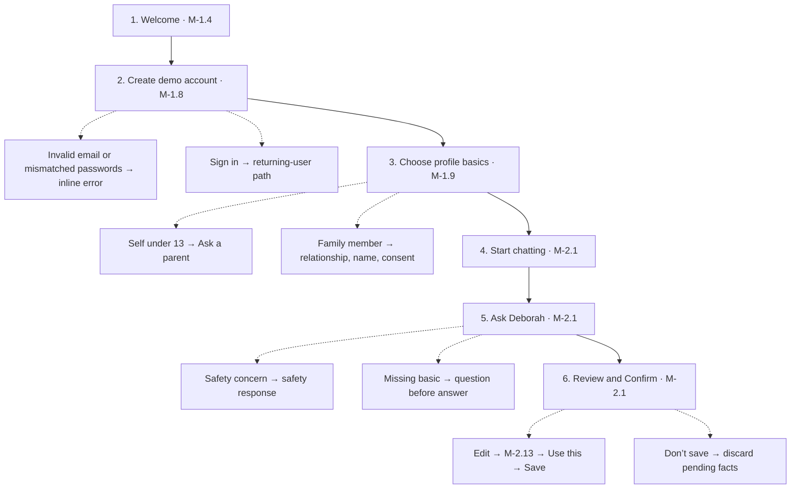

<a id="self-age-gate"></a>

## Self under 13 — age gate

Sarah · IMPLEMENTED · Start: S03

Local age gate; full date of birth (PDF under-13).

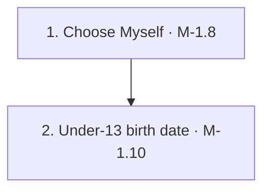

<a id="teen-onboarding"></a>

## Teen dependent onboarding

Emily · IMPLEMENTED · Start: S20

One account holder manages the dependent. No invitation, separate login or sharing permissions.

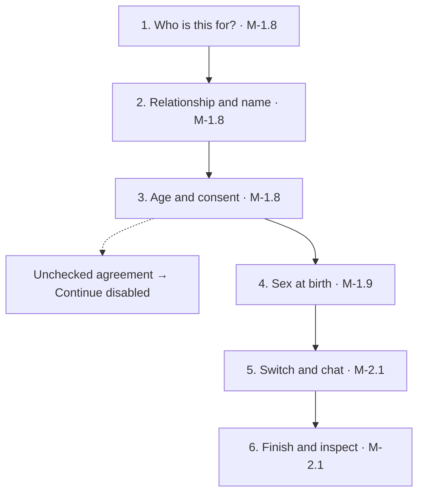

<a id="child-onboarding"></a>

## Child dependent onboarding

Emily · IMPLEMENTED · Start: S20

One account holder manages the dependent. No invitation, separate login or sharing permissions.


<a id="adult-onboarding"></a>

## Adult partner onboarding

Helen · IMPLEMENTED · Start: S21

One account holder manages the dependent. No invitation, separate login or sharing permissions.


<a id="chat-profile"></a>

## Health profile through conversation

Sarah · IMPLEMENTED · Start: S14

Scripted questions and answers; local pending/confirmed facts.

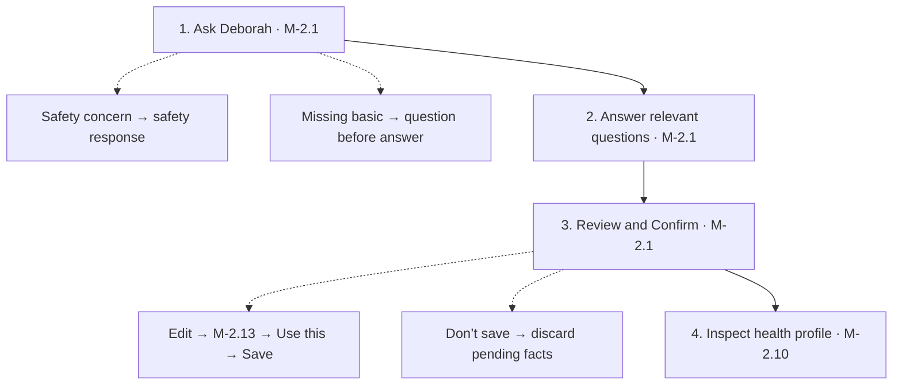

<a id="returning"></a>

## Returning user consultation

Maria · IMPLEMENTED · Start: R01

Seeded account and history; responses are scripted.

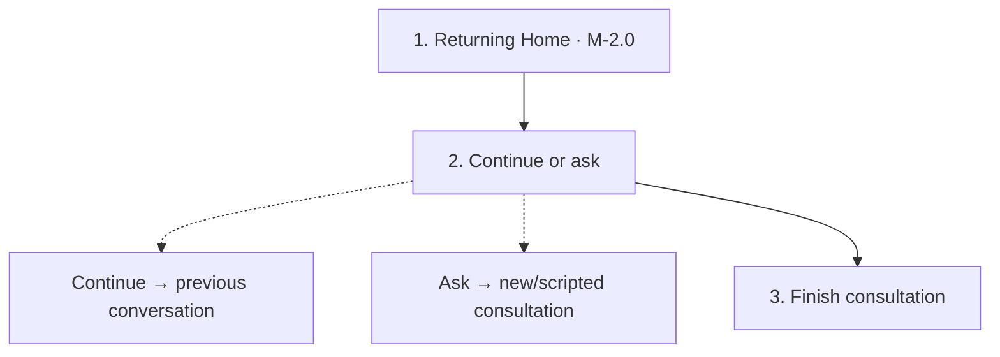

<a id="signin"></a>

## Sign in and restore history

Maria · IMPLEMENTED · Start: S01

Any demo credentials and six digits restore R01; no real authentication.

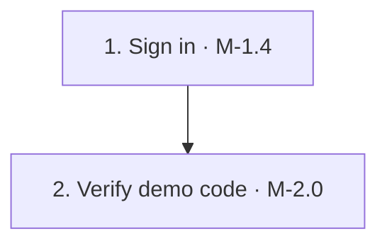

<a id="review-save"></a>

## Review facts — save

Elena · IMPLEMENTED · Start: S19

Seeded answer with three pending facts; writes remain local.

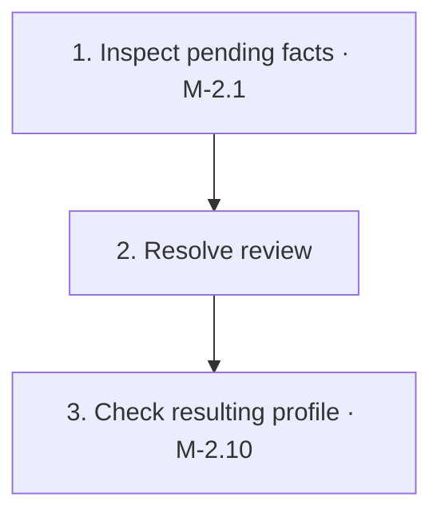

<a id="review-edit"></a>

## Review facts — edit

Elena · IMPLEMENTED · Start: S19

Seeded answer with three pending facts; writes remain local.

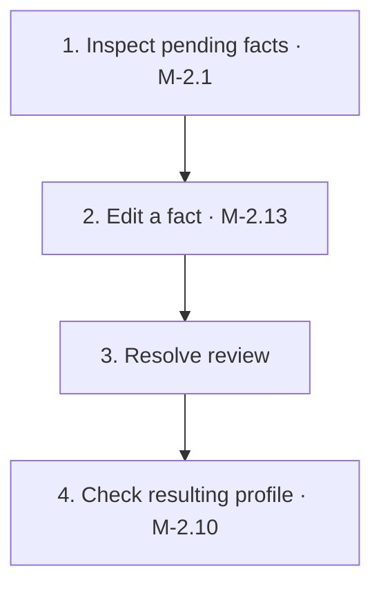

<a id="review-discard"></a>

## Review facts — discard

Elena · IMPLEMENTED · Start: S19

Seeded answer with three pending facts; writes remain local.


<a id="family-add"></a>

## Add and switch family profiles

Emily · IMPLEMENTED · Start: S09

Managed profiles in one local account, not separate users.

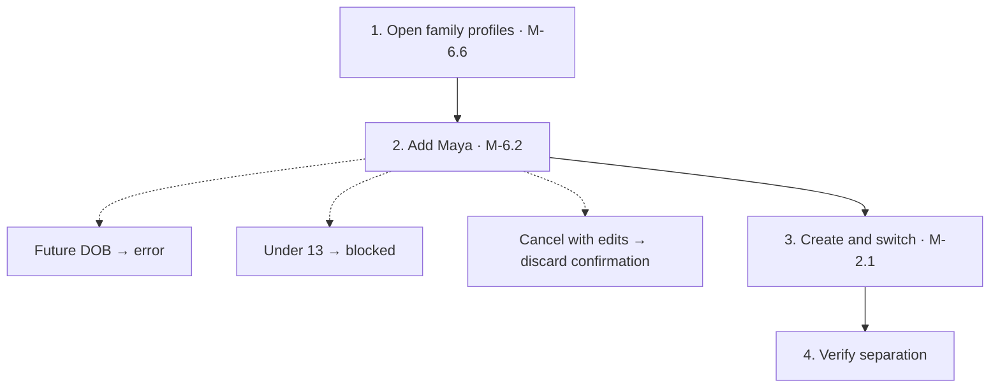

<a id="teen-invitation"></a>

## Teen invitation and sharing

Emily · NOT IMPLEMENTED · Start: unavailable

Unavailable. Managed dependent profiles do not provide a separate login.

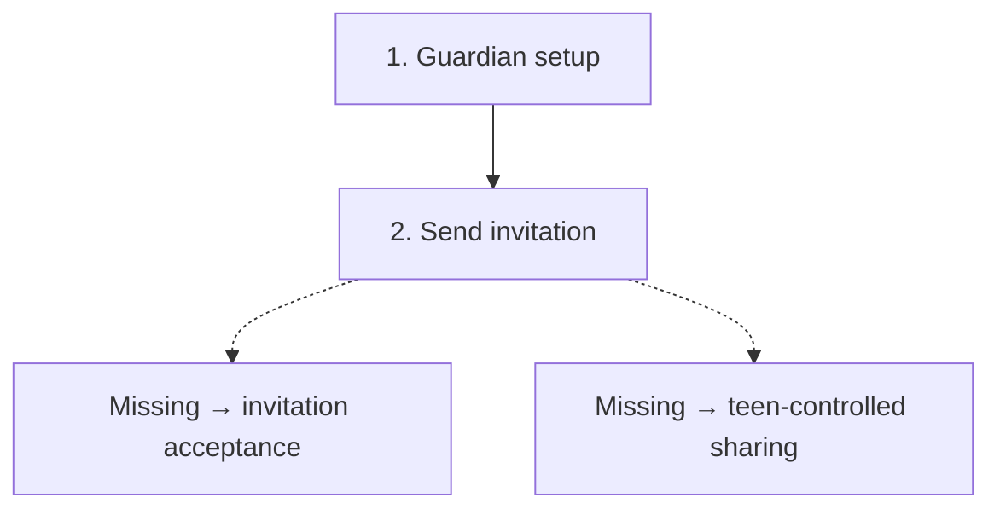

<a id="adult-invitation"></a>

## Adult invitation and access permissions

Helen · NOT IMPLEMENTED · Start: unavailable

Unavailable. The adult agreement checkbox is not recipient approval or access enforcement.

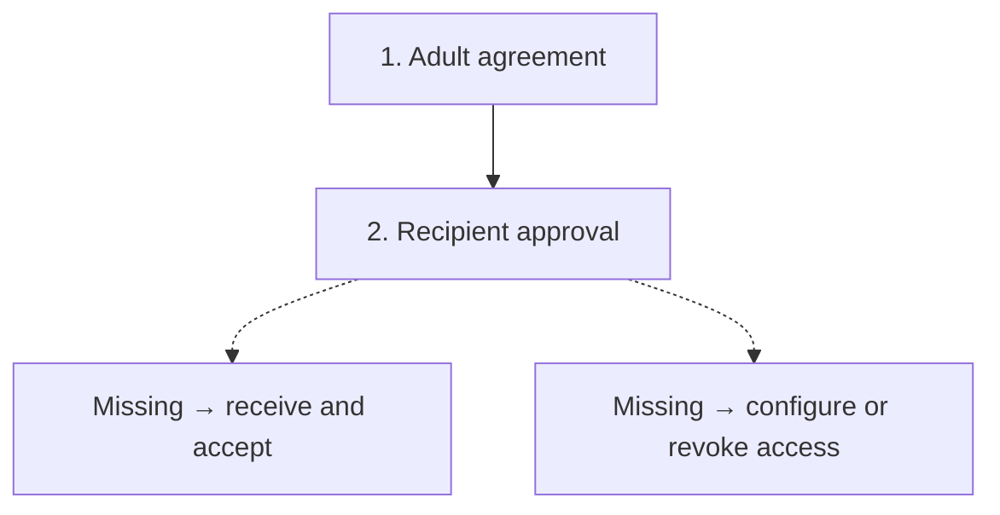

<a id="labs-upload"></a>

## Lab attachment and confirmation

Maria · PARTIALLY IMPLEMENTED · Start: S08

Photo view is simulated. PDF selection uses a real picker, but contents are never read or uploaded; all files map to the same sample.

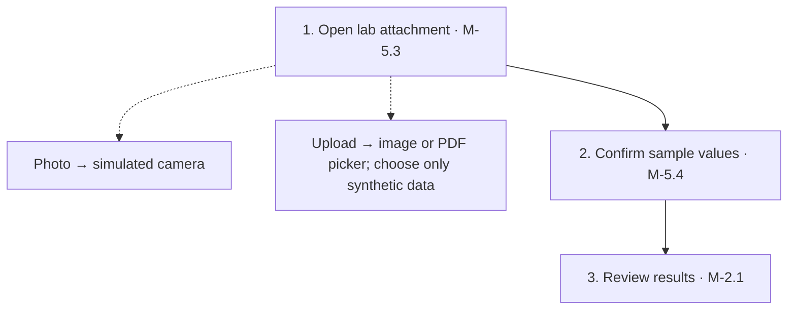

<a id="labs-analysis"></a>

## Lab-informed answer and records

Maria · PARTIALLY IMPLEMENTED · Start: S08

Seeded lab values and scripted analysis; not AI document understanding.

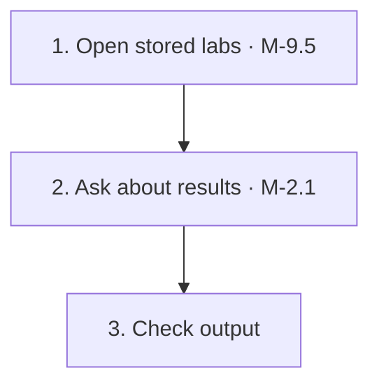

<a id="visit-notes"></a>

## Doctor visit notes

Maria · PARTIALLY IMPLEMENTED · Start: S08

Text editor and local autosave. No visit audio recording or transcription.

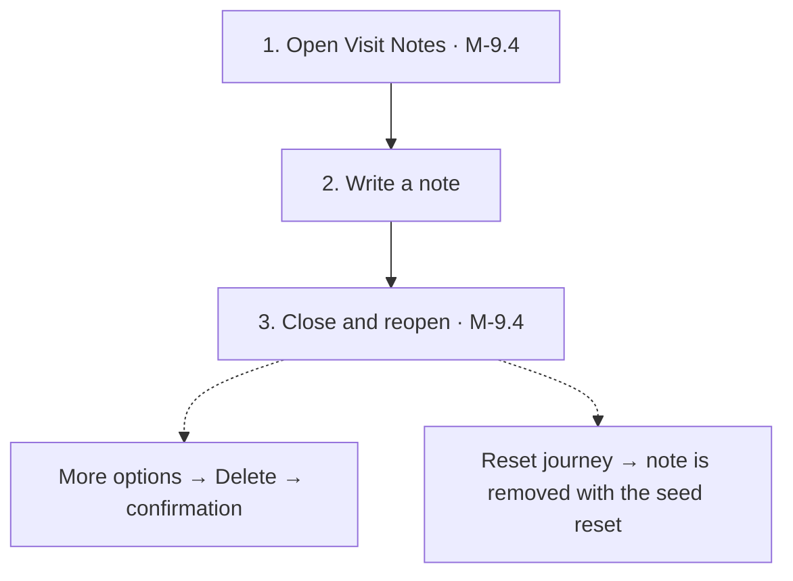

<a id="provider-brief"></a>

## My Visit Notes — provider brief

Maria · IMPLEMENTED · Start: S24 (or S04 → Discuss with provider)

Miro Step 5: structured brief for the clinician. Enough detail = full 7-section guidance. Save / PDF, then appointment-date follow-up.

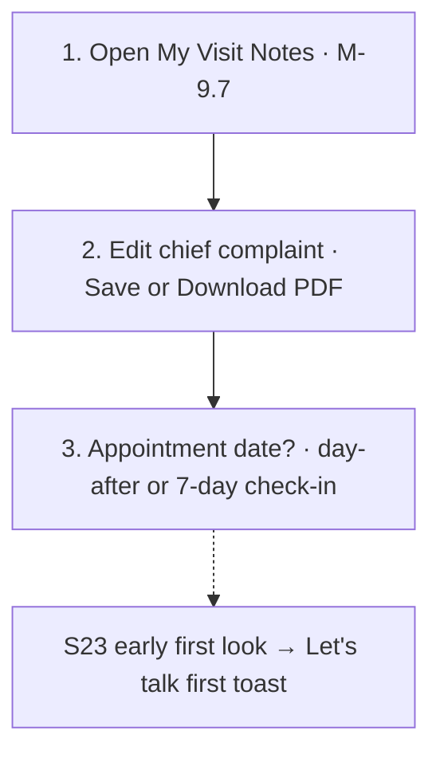

<a id="medication-update"></a>

## Medication update and conflict limits

Elena · PARTIALLY IMPLEMENTED · Start: S19

Structured review/edit/confirm exists. General medication reconciliation and conflict resolution are not implemented.

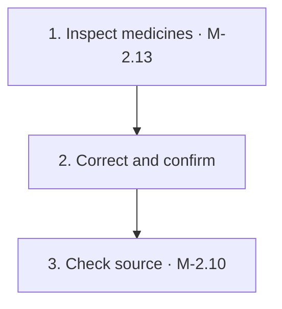

<a id="history"></a>

## Conversation history and continuation

Maria · IMPLEMENTED · Start: R01

Local seeded transcript; PDF is an HTML preview and Share copies text.

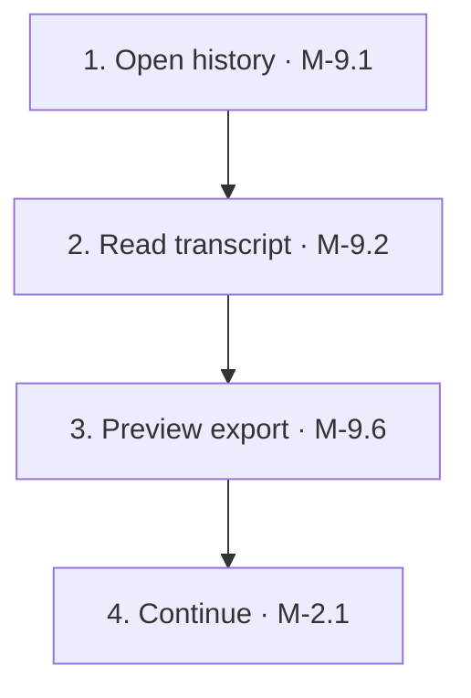

<a id="account-privacy"></a>

## Account and privacy controls

Maria · IMPLEMENTED · Start: R01

Export request, notifications and account deletion affect mock state only; no email or remote deletion occurs.

```mermaid
flowchart TD
  N0["1. Open Settings · M-10.1"]
  N1["2. Notifications and legal"]
  N0 --> N1
  N2["3. Request demo export · M-10.2"]
  N1 --> N2
  N3["4. Test local deletion"]
  N2 --> N3
  N3 -.-> B3_0["Cancel → preserve state"]
  N3 -.-> B3_1["Confirm → local reset"]
```

<a id="followup"></a>

## Follow-up reminder and check-in

Maria · IMPLEMENTED · Start: S07

Simulated lock screen and notification delivery, not OS push.

```mermaid
flowchart TD
  N0["1. Open reminder · M-2.1"]
  N1["2. Reply to check-in · M-2.1"]
  N0 --> N1
  N1 -.-> B1_0["Better → progress response"]
  N1 -.-> B1_1["Same/worse → follow-up questions or labs"]
```

<a id="upgrade"></a>

## Trial limit and plan selection

Maria · IMPLEMENTED · Start: S06

Prices and payment are mock UI; no purchase or card transaction occurs.

```mermaid
flowchart TD
  N0["1. Trial limit · M-4.2"]
  N0 -.-> B0_0["Maybe later → return to app"]
  N1["2. Choose plan · M-4.5"]
  N0 --> N1
  N2["3. Return to chat · M-2.1"]
  N1 --> N2
```

<a id="family-upgrade"></a>

## Family plan gate

Maria · IMPLEMENTED · Start: S10

Simulated subscription gate.

```mermaid
flowchart TD
  N0["1. Try adding a person · M-6.3"]
  N1["2. Inspect plan choice · M-4.2"]
  N0 --> N1
  N1 -.-> B1_0["Not now → close gate"]
```

<a id="booking"></a>

## Escalation and booking

Maria · IMPLEMENTED · Start: S12

Local availability, sharing checkbox and payment simulation; no real appointment.

```mermaid
flowchart TD
  N0["1. Trigger escalation · M-2.1"]
  N1["2. Select a slot · M-8.2"]
  N0 --> N1
  N2["3. Confirm mock appointment · M-8.4"]
  N1 --> N2
```

<a id="emergency"></a>

## Emergency safety

Maria · IMPLEMENTED · Start: S13

Scripted guardrail matching; clinical copy is placeholder. Emergency and crisis simulate care-team prioritization/notify (demo toast + conversation.teamAlert). Crisis actions open a bottom sheet (911, 988, text line). Urgent non-emergency red flags advise care within 24 hours / first business day.

```mermaid
flowchart TD
  N0["1. Capture baseline"]
  N1["2. Send safety input · M-2.1"]
  N0 --> N1
  N2["3. Verify outcome"]
  N1 --> N2
```

<a id="medication-safety"></a>

## Medication safety

Maria · IMPLEMENTED · Start: S13

Scripted guardrail matching; clinical copy is placeholder.

```mermaid
flowchart TD
  N0["1. Capture baseline"]
  N1["2. Send safety input · M-2.1"]
  N0 --> N1
  N2["3. Verify outcome"]
  N1 --> N2
```

<a id="out-of-scope"></a>

## Out-of-scope question

Maria · IMPLEMENTED · Start: S13

Scripted guardrail matching; clinical copy is placeholder.

```mermaid
flowchart TD
  N0["1. Capture baseline"]
  N1["2. Send safety input · M-2.1"]
  N0 --> N1
  N2["3. Verify outcome"]
  N1 --> N2
```

<a id="guidance-happy"></a>

## Guidance — happy path + What’s next

Alex / Maria · IMPLEMENTED · VERIFIED 16 Oct 2026 · Auto: ▶ Journeys → Guidance · happy path + Book (S01 E2E) · Manual shortcut: [S04](http://127.0.0.1:5173/mobile?scenario=S04) · Spec: [F02e](docs/ux/F02e-guidance.md)

Chevron (auto): Welcome → sign-up → Myself profile → Start chatting → headaches intake → 7 sections → Review Save → What’s next → **Book a consultation** → M-8.2 → Journey finished. Manual S04 skips to answered chat + What’s next. Spine stops at Book (not Discuss with provider / M-9.7).

```mermaid
flowchart TD
  N0["1. S01 onboarding · or open S04"]
  N1["2. Guidance + What’s next · M-2.1"]
  N0 --> N1
  N2["3. Book a consultation → M-8.2"]
  N1 --> N2
```

<a id="guidance-early"></a>

## Guidance — early first look

Maria · IMPLEMENTED · Start: S23 · Spec: [F02e](docs/ux/F02e-guidance.md)

Chevron: Ask for guidance > enough details? no > early first look (what’s still missing) > answer remaining questions > ask for guidance again > 7 sections.

```mermaid
flowchart TD
  N0["1. Open mid-intake · S23"]
  N1["2. Tell me what you think · M-2.1"]
  N0 --> N1
  N2["3. Finish intake · ask again"]
  N1 --> N2
```

<a id="guidance-uncovered"></a>

## Guidance — out of coverage

Maria · IMPLEMENTED · Start: S13 · Spec: [F02e](docs/ux/F02e-guidance.md)

Chevron: Safety bench Uncovered > send > finish intake if needed > Tell me what you think > team handoff toast + Book (uncounted). Phrase: cataract surgery recovery.

```mermaid
flowchart TD
  N0["1. Insert Uncovered · S13"]
  N1["2. Send and request guidance · M-2.1"]
  N0 --> N1
  N2["3. Confirm toast + Book · M-8.2"]
  N1 --> N2
```

<a id="guidance-labs"></a>

## Guidance — lab summary refresh

Maria · IMPLEMENTED · Start: S04 · Spec: [F02e](docs/ux/F02e-guidance.md)

Chevron: What’s next > Upload labs > M-5.3 > confirm > updated 7-section summary in same chat (same-topic refresh uncounted).

```mermaid
flowchart TD
  N0["1. What’s next · Upload labs · S04"]
  N1["2. Add and confirm labs · M-5.3"]
  N0 --> N1
  N2["3. Updated summary · M-2.1"]
  N1 --> N2
```
