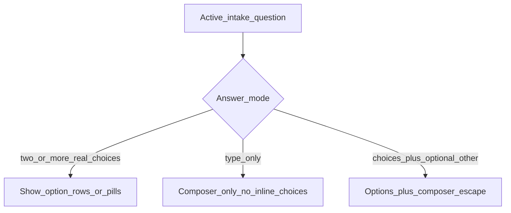

# F02d — Session intake answer modes (composer vs options)

**Goal:** Stop Ask Dibora session questions from showing a redundant “I’ll type…” pill next to the bottom composer. Keep real choice questions and the typed-answer escape hatch working.

**Related:** [F02-consultation.md](F02-consultation.md) · Ask Dibora session questions in `src/shared/data/conversation/intake.json` · M-2.1 Conversation

**Status:** Implementation guide (2026-10-16). Clinical copy remains placeholder.

---

## Problem

On free-text session prompts (e.g. “What’s one health goal this year…”), the UI currently shows:

1. An inline **pill** such as “I’ll type my goal…”
2. The **Composer** with “Or type something else…”

Both invite typing. That is confusing and looks like a broken dual control.

---

## Answer modes (product rule)

Every active intake question uses exactly one mode:

| Mode | When | Inline UI | Composer |
|------|------|-----------|----------|
| **Choice** | 2+ meaningful tap options (not “type invite”) | Option pills/rows | Optional secondary (“Or type…”) |
| **Free-text** | Question expects typed content only | **None** (no pills/rows) | **Required** — primary answer surface |
| **Hybrid** | Real choices + optional Other / free text | Options for the discrete answers | Kept for Other / typed escape |

### Session question mapping (target)

| Question id | Mode | Notes |
|-------------|------|--------|
| `session-concern` | Hybrid | “Yes, that’s it” / “Something else…” + composer for rewrite |
| `session-other` | Expand hybrid | “None” / “Yes” → issue pills; “Other…” → bottom composer only (no inline form) |
| `session-goal` | **Free-text** | No type-invite pill; composer only |
| `session-meds` | Expand hybrid | “None” / “Yes” → med pills; “Other…” → bottom composer only |
| `session-complete` | Choice | “Yes, that’s everything” / “I have more to add” |

Red-flag multi-selects, consent, DOB/sex wheels, and journey quizzes stay on their existing modes. Do not change them for this fix.

---

## Why it breaks today

1. **Data** — `session-goal` is modeled as a quiz with a single option `{ id: "other", label: "I'll type my goal…" }`.
2. **Widget** — `IntakeQuestion` always mounts `QuestionChoices`, which renders `ChoicePills` for short labels. It also auto-appends an “Other…” option when none exists.
3. **Screen** — `Conversation` keeps the Composer visible for any active `quiz` so free text can call `answerIntake` / complete the current question.

So a type-only question is still a “choice,” which forces a pill while the composer is already the answer path.

---

## How to fix without breaking anything

### Do

1. **Mark free-text explicitly in data** — Prefer extending question `input` with `'text'` (or a `composerOnly: true` flag) on `session-goal` (and any future type-only session Q). Set `options: []`. Do **not** rely only on “single other option” heuristics that might hide a real one-option quiz later.
2. **Pass the flag through the engine** — In `nextIntakeOrReady` (`plans.ts`), copy `input: 'text'` onto `IntakeMeta` like year/height/weight.
3. **IntakeQuestion early exit** — If `intake.input === 'text'` (or composerOnly), render **nothing** (or a quiet one-line hint). Skip `QuestionChoices`. Do not auto-append “Other…”.
4. **Conversation composer** — Keep Composer for free-text and hybrid. Change placeholder for free-text to a direct prompt (e.g. “Type your goal…”) instead of “Or type something else…”. Keep existing `send` → `answerIntake(..., ['other'], text)` / free-text intake path for hybrid and free-text.
5. **Leave hybrid choices alone** — `session-concern`, `session-other`, `session-meds` still show options; composer remains the escape hatch.

### Do not

- Hide the Composer for **all** intake / `profiling` — that breaks hybrid Other and the typed-answer path already in `Conversation.tsx`.
- Delete `ChoicePills` / `QuestionChoices` — choice and hybrid questions need them.
- Reintroduce long female/male symptom checklist clarifiers.
- Change emergency / crisis sheet or team-notify behaviour.
- Auto-confirm pending facts without Review and Confirm.

### Safe change checklist (before you ship)

- [ ] `session-goal`: no “I’ll type…” pill; composer visible; Send answers the question and advances intake.
- [ ] `session-concern` / `session-other`: options still tappable; typing still works for Other.
- [ ] `session-complete`: Yes / more still works; “more” still opens composer loop.
- [ ] Red-flag multi-select + Done unchanged.
- [ ] Health consent / DOB year wheel unchanged.
- [ ] `npm run typecheck` clean; lint clean on touched files.
- [ ] Smoke: empty Ask → suggestion → through session questions → completeness → ready/answer.

---

## File map

| Concern | File |
|---------|------|
| Question definitions | `src/shared/data/conversation/intake.json` |
| Content / meta types | `src/shared/types/content.ts`, `src/shared/types/domain.ts` (`IntakeMeta.input`) |
| Emit intake message | `src/shared/engine/plans.ts` (`nextIntakeOrReady`) |
| Inline widgets | `src/apps/mobile/patterns/chat/IntakeQuestion/IntakeQuestion.tsx` |
| Composer visibility / placeholder | `src/apps/mobile/screens/consultation/Conversation/Conversation.tsx` |
| Choice rendering | `src/apps/mobile/patterns/widgets/QuestionChoices/`, `ChoicePills/` |

---

## Suggested implementation order

1. Types + `intake.json` free-text flag for `session-goal`.
2. `IntakeQuestion` skip choices for free-text.
3. `Conversation` placeholder + any `quizIsFreeText` helper.
4. Manual smoke on S02 / returning Ask path.
5. Keep this doc as the authority when adding new session questions.

---

## Acceptance (this fix only)

- Free-text session questions never show a type-invite pill.
- Composer is the sole primary control for those questions.
- Choice and hybrid questions still show options and do not lose the typed escape hatch.
- No major UI redesign beyond removing the redundant pill and clarifying the placeholder.
